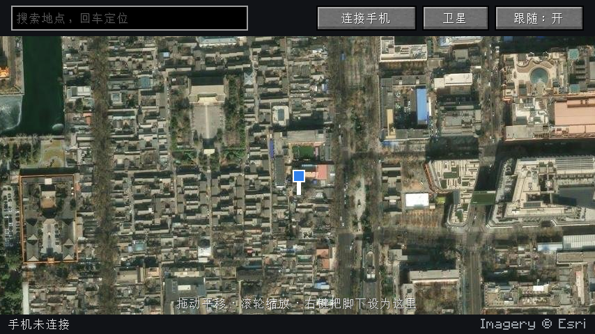

# MC Run

Minecraft Fabric 模组（1.21.11）：把玩家在 MC 里的坐标换算成真实经纬度，通过 USB 实时设为 iPhone 的系统定位。你在 MC 里走一步，手机定位也走一步。

游戏里按 M 打开真实地图（卫星 / 街道），能看到自己"站在"地球上的哪里，右键或搜索地名就能把脚下设为那里。



手机通信沿用 [iphone-location-controller](https://github.com/xiaogao860/iphone-location-controller) 的做法：pymobiledevice3 → 挂载开发者镜像 → 用户态 RSD 隧道 → DVT LocationSimulation。

## 安装

1. 安装 Fabric Loader 0.20.1+ 和 Fabric API（1.21.11 版）。
2. 从 [Releases](../../releases) 下载 `mcrun-<版本>.jar`，放进 mods 文件夹（HMCL 开了版本隔离时是 `versions/<版本名>/mods/`）。
3. 电脑上要有 Python 3.9+：
   - Mac：系统自带（没有的话终端运行 `xcode-select --install`）。
   - Windows：从 python.org 安装 Python 3.11 并勾选 Add to PATH；另需 Apple 设备驱动（装 iTunes）。

第一次点"连接手机"会在 `.minecraft/mcgps/runtime/` 建立 Python 运行环境并安装 `pymobiledevice3==11.27.2`，约 120 MB，需要联网，1～3 分钟。以后连接直接启动。

## 手机

- iOS 17.4 以上，打开开发者模式（设置 → 隐私与安全性 → 开发者模式）。
- 数据线连接电脑，解锁，点"信任"。一次只接一部。

## 用法

| 操作 | 作用 |
| --- | --- |
| M | 打开真实地图 |
| 地图上右键 | 把脚下这一格设为点到的地点 |
| 地图搜索框回车 | 搜索地名，定位过去并把脚下设为那里 |
| 拖动 / 滚轮 | 平移 / 缩放 |
| 连接手机 / 断开手机 | 开始同步 / 恢复真实定位 |
| 速度 | 展开速度面板：拖动设置"疾跑时手机速度"和"最高速度" |
| 卫星 / 街道 | 切换底图 |
| 跟随 | 地图是否跟着玩家走 |

"暂停 / 继续同步"按键默认未绑定，可在 选项 → 控制 → 按键绑定 → MC Run 里设置。

## 指令

| 指令 | 作用 |
| --- | --- |
| `/mcrun` | 当前状态、脚下对应的经纬度、映射参数 |
| `/mcrun connect` / `disconnect` | 连接 / 断开（断开会恢复真实定位） |
| `/mcrun here <纬度> <经度>` | 脚下这一格对应这个地点 |
| `/mcrun scale <米>` | 1 格等于多少米，默认 1 |
| `/mcrun rotation <度>` | MC 北方顺时针转多少度对应真北，默认 0 |
| `/mcrun maxspeed <km/h>` | 手机位置最快移动速度，0 为不限；限速后传送会"跑"过去 |
| `/mcrun rate <次/秒>` | 发送频率，默认 4 |
| `/mcrun nether scale8` / `pause` | 下界坐标 ×8 / 下界中保持位置 |
| `/mcrun pause` / `resume` | 暂停 / 继续同步 |
| `/mcrun hud on` / `off` | 左上角状态角标 |
| `/mcrun map` | 打开地图 |
| `/mcrun python <路径>` | 指定用来建运行环境的 Python |
| `/mcrun reinstall` | 删除运行环境，下次连接时重装 |

旧指令 `/mcgps` 仍然可用。设置保存在 `.minecraft/config/mcgps.json`。

## 映射规则

- +X 为东，−Z 为北，1 格默认 1 米，以锚点为中心沿大圆换算，坐标系 WGS-84。
- 改比例或朝向时，脚下的真实位置保持不变。
- 末地中保持最后位置。
- 手机速度 = MC 移动速度 × 比例。"疾跑时手机速度"就是在调比例（MC 疾跑 5.6 m/s、步行 4.3 m/s）。速度按游戏 tick 计算，`/tick rate` 改过也准。
- 只同步位置，不同步朝向：iOS 模拟定位接口只接受经纬度，指南针朝向来自手机磁力计。手机上的"移动方向"由 iOS 根据前后位置推算。
- 每秒最多发送 4 次，同一时间只有一条未确认指令；手机 12 秒未确认会暂停同步，`/mcrun resume` 重试。
- 关闭游戏时会先让手机恢复真实定位再退出。拔线或强制结束游戏时可能来不及恢复：重新连接再断开，或重启手机。

## 构建

需要 JDK 25 运行 Gradle（Loom 1.19；编译目标仍是 Java 21）：

```bash
./gradlew build
```

产物在 `build/libs/`。

`./gradlew runClientGameTest` 会自动开一个测试世界，检查坐标映射、比例、限速，并截地图图。连接流程只在 `MCGPS_TEST_CONNECT=1` 时测，而且要先拔掉 iPhone，否则会真的改手机定位。

## 许可

GPL-3.0，与 pymobiledevice3 和 iphone-location-controller 一致。地图瓦片来自 Esri World Imagery 和 OpenStreetMap，地名搜索使用 OpenStreetMap Nominatim。
